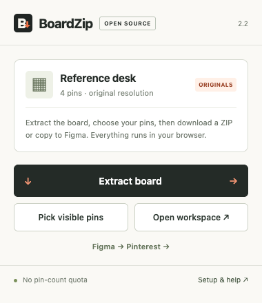

# BoardZip — Pinterest ↔ Figma

**[Website](https://ayushkumar0.github.io/boardzip/) · [Downloads](https://github.com/ayushkumar0/boardzip/releases/latest) · [Issues](https://github.com/ayushkumar0/boardzip/issues)**



A personal, local Chrome extension plus a companion Figma/FigJam plugin. Inspired by Pinpasta's extension + plugin workflow, with an original implementation and no pin-count paywall. No account sharing, backend, license server, analytics, or remote executable code. Chrome 116 or newer is required. Licensed under MIT.

## Install both pieces

### Chrome

1. Extract `BoardZip-Pinterest-Figma-Kit.zip` into a permanent folder.
2. Open `chrome://extensions`, turn on **Developer mode**, and choose **Load unpacked**.
3. Select the kit's `extension` folder and pin BoardZip.
4. If you installed the previous build, reload its extension card and refresh your Pinterest tab. The project's existing `BoardZip-Chrome-Extension` folder is also updated by the build script.

### Figma / FigJam

1. Open a design file in **Figma Desktop**.
2. Use **Plugins → Development → Import plugin from manifest…** and select `figma-plugin/manifest.json` from the kit.
3. Run **BoardZip — Pinterest ↔ Figma** from the Development plugins menu.

The supplied manifest does not invent a published plugin ID. If Figma requires an ID in your version, create a new development plugin in Figma, copy its generated `id` into this manifest, then import it. That registration step needs your Figma account. Native Figma installation has not been verified on this machine; Figma Desktop is not installed here.

## Pinterest → ZIP or Figma

1. Sign in to Pinterest in Chrome and open a board/section in its full pin view.
2. Click BoardZip to open its compact toolbar popup, then **Extract board**. The persistent Chrome side panel opens for collection and selection. Choose **Open workspace** when you want more room. It first checks public board data against Pinterest’s pin count. Larger/private boards use embedded board data and authenticated feed pagination, with scrolling and section scans as a fallback. It has no fixed pin or pagination limit.
3. Review the thumbnail grid. Use **Select all**, **Select none**, and individual checkboxes to choose your pins.
4. Choose **Download selected ZIP**, **Copy selected to Figma**, or **Save Figma transfer file**.
5. For Figma, run the plugin, paste the copied transfer or load the JSON file, and choose **Import to canvas**.

**Collect visible pins** collects only pin cards intersecting the viewport of the Pinterest tab you opened BoardZip from. It does not scroll that tab. You can uncheck further pins in the preview. This is pin selection, not a screenshot crop.

Figma imports images as separate image layers in a configurable grid. Set canvas width to 0 for original dimensions or choose a smaller display width; the full image remains embedded. Pinterest source links and original dimensions are stored on each imported layer. Select an imported image and use **Open selected pin source** to return to its Pinterest pin.

The clipboard transfer contains image URLs and metadata, not your session/cookies. The plugin fetches image files directly from Pinterest's CDN. PNG/JPEG import directly; WebP, AVIF, and GIF import as PNG pixels at the original decoded dimensions. GIF imports use a single frame. Failures are listed, not silently replaced.

## Figma selected-area downloads

1. Select frames, layers, or groups. To crop an exact canvas rectangle, create a **Figma slice** over that area and select the slice.
2. Run BoardZip and open **Export / Pinterest**.
3. Choose PNG, JPG, SVG, or PDF. PNG/JPG support 1×–4× scale.
4. Enable **Combine selection into one area** to export multiple selections together, or leave it off to export each separately.
5. Click **Download selection ZIP**.

Combined export in Figma Design uses temporary clones, preserving absolute placement and removing the temporary frame afterward. Originals remain in the file. Nested selected layers are deduplicated. A Figma slice gives the most faithful crop of rendered content when appearance depends on ancestor clipping, blending, or effects. In FigJam, use separate exports, or group the selected objects and export that group. Combined temporary-frame export is for Figma Design.

These are rendered/vector exports, not a transfer of editable Figma design layers. Native export capabilities and asset-size limits still apply. Increasing export scale cannot add missing detail to a low-resolution bitmap.

## Figma → Pinterest

1. Select your Figma frames/layers/slice and click **Prepare Pinterest transfer** in the plugin. This renders PNG files at your chosen scale and saves `Figma-to-Pinterest.boardzip.json`.
2. In Chrome's BoardZip, open **Figma → Pinterest**, then load the JSON. Alternatively click **Copy Pinterest transfer** in the plugin and use **Load pasted transfer** in Chrome.
3. Click **Prepare Pinterest upload** on an image. BoardZip opens Pinterest's Create Pin screen and supplies the image to its upload field.
4. **Verify the preview, add a title, choose your board, and publish in Pinterest.** BoardZip does not automate the final Publish action.

If Pinterest changes the form or redirects to sign-in, download the displayed image and upload it in Pinterest manually. Each exported image is prepared separately. This is a transfer into a new pin, not continuous two-way synchronization of board membership and Figma layers.

## Resolution and collection limits

- **Originals only** is enabled by default. The extension and plugin try the original CDN URL with different extensions. The extension decodes the response and records pixel dimensions. Unavailable/blocked originals are failures.
- Disable originals-only to allow the largest *discovered* preview when an original is unavailable. The ZIP report labels fallbacks. Images in Pinterest ZIPs are stored without recompression or upscaling.
- Pinterest's original is the uploaded file it exposes, which may differ from an external source. The tool cannot restore missing source detail or prove that an undocumented CDN URL is the largest asset in every case.
- Image pins and video covers are supported. Video/audio streams and full carousel/Idea Pin media exports are not implemented.
- Collection checks the board’s advertised pin count. Public widget results are accepted as complete only when the unique pin count matches; partial widget samples are discarded. Board-feed pagination continues to its end cursor without a fixed page/pin quota. Scrolling fallback waits roughly 30 seconds for the bottom to settle and does not stop at an ideas heading. Layout changes, delayed loads, hidden sections, recommendation markup, and virtualized content can affect the inventory. Known recommendation containers/headings are excluded. **This is not a server-confirmed complete board inventory.** Compare counts; export undiscovered sections separately.
- Stops preserve collected pins or completed image downloads. Closing the export page ends the run; resume-after-closing is not implemented. Pins remain available for subsequent exports while the page stays open, but image downloads are not cached across runs.
- Pinterest ZIPs target 200 MB per archive. Pinterest downloads have no configured per-image byte cutoff. Figma imports remain limited to 100 MB per image and Figma-to-Pinterest transfer JSON to 300 MB; these bridge limits do not cap Pinterest board ZIP downloads. These are memory safeguards, not a pin-count quota. Keep export pages open and check Chrome Downloads for completed saves.
- Supported Pinterest domains: .com, .co.uk, .in, .ca, .de, .fr, .com.au and their subdomains. Accessible private boards use your existing Chrome session. Figma/FigJam imports need access to the image CDN.

## Reports, privacy, and permissions

ZIPs include an `export-report.json`. Pinterest also exports a complete report covering all ZIP parts, failures, unprocessed selected pins, source URLs, and pixel dimensions. Large archives are numbered independent ZIP files.

Chrome permissions: `scripting` reads/scrolls Pinterest and prepares its upload field; `activeTab` initializes the clicked tab; host permissions cover Pinterest/CDN; `downloads` saves files; `clipboardWrite` copies transfers; `sidePanel` opens the persistent Chrome panel. The Figma plugin network allowlist contains only `https://i.pinimg.com`. Passwords, authentication tokens, and cookies are not read/exported. Image fetches omit credentials. No extension-owned server receives your images; Pinterest receives normal requests, and imported images become part of your Figma file according to Figma's own storage/sync behavior.

## Build and validation

No build-time dependencies are needed to package the extension/plugin:

```
python3 scripts/build.py
node --test tests/*.test.mjs
```

The build generates the plugin's single-file UI, updates both distributable ZIPs, and refreshes the existing extracted Chrome folder if present. Source: `extension/`, `figma-plugin/code.js`, `figma-plugin/src/`.

Validation completed on this build:

- 20 Node fixture tests: URL/domain validation, selected-only transfers, payload validation, original/fallback ordering, ZIP CRCs/Unicode/binary content, virtualized pin collection, recommendation exclusions, sections, visible-only collection, cancellation, simulated Figma import/grid/source metadata, deduplicated selection export, absolute transforms, and cleanup after failed combined exports.
- Real Chrome for Testing with the extension loaded: mocked Pinterest board/section extraction, checkbox selection, original extension fallback, image decoding, ZIP/report generation, selected-only transfer, Figma JSON upload/paste loading, and Create Pin file-input staging. The fixture delays navigation of newly created tabs so browser interception attaches first. It does not verify Pinterest's live website.
- Plugin UI in a real browser iframe with a simulated Figma host: URL transfer import, native-message image bytes, selected ZIP generation, combined export settings, and reverse PNG transfer.
- Independent Python ZIP verification, including exported image byte equality. UI screenshots were inspected.

**Live public-board verification:** the updated extension collected and downloaded all 49 pins advertised by a public reference board during the test on 12 October 2026. All 49 used original-file URLs, with zero failures/unprocessed pins. Personal exports and reports are excluded from this public repository. The board initially reported 45 pins and increased during testing. Pagination regressions also cover 13 initial cards becoming 45 pins, inline ideas headings, repeated cursors, recommendation-cache exclusion, and 1,200 pins across 12 pages.

**Live signed-in feed pagination on large/private boards, actual Create Pin form behavior, and native Figma plugin installation/canvas/export remain unverified.** The Figma canvas tests use simulated APIs and are not evidence of a native Figma run. This is a development build, not a Chrome Web Store or Figma Community listing.

Optional browser fixtures require Playwright and Chrome for Testing:

```
BOARDZIP_PLAYWRIGHT=/path/to/playwright BOARDZIP_CHROMIUM=/path/to/chrome node tests/browser.cjs
BOARDZIP_PLAYWRIGHT=/path/to/playwright BOARDZIP_CHROMIUM=/path/to/chrome node tests/figma-ui.cjs
```

## Reference and API documentation

- Pinpasta workflow: https://pinpasta.hehe.studio/learn/pinterest-to-figma
- Chrome scripting: https://developer.chrome.com/docs/extensions/reference/api/scripting
- Chrome host permissions: https://developer.chrome.com/docs/extensions/develop/concepts/network-requests
- Chrome downloads: https://developer.chrome.com/docs/extensions/reference/api/downloads
- Figma plugin manifest: https://developers.figma.com/docs/plugins/manifest/
- Figma image import: https://developers.figma.com/docs/plugins/working-with-images/
- Figma native export: https://developers.figma.com/docs/plugins/api/properties/nodes-exportasync/
- Pinterest Create Pin: https://help.pinterest.com/en/article/create-a-pin-from-an-image-or-video


## Website and releases

The buildless landing page lives in `docs/`. `python3 scripts/build.py` also populates its `downloads/` folder with current extension/plugin ZIPs and an original sample-design ZIP. `.github/workflows/pages.yml` tests the source, builds these downloads, and deploys `docs/` to GitHub Pages. No downloaded Pinterest artwork is published with the site.

The toolbar popup launches the side panel, which owns collection/download work. The popup can close after launch. Keep the side panel open for the run; closing that panel still ends it. The full workspace can copy a completed selection from the side panel but does not move an in-progress export.

## Contributing

Run `node --test tests/*.test.mjs` and `python3 scripts/build.py`. Optional browser tests require Playwright and Chrome for Testing; they use fixtures. Report live Pinterest layout/count issues with the extension version and a public test-board URL. Do not include cookies, tokens, private-board exports, or other personal data in issues.


### v2.2 interface validation

The toolbar popup was tested with a fixture board, including its title/count lookup. Chrome accepted the real `sidePanel.open` call from a browser click. Native side-panel targets are not exposed as normal Playwright pages in the headless test, so the same panel document was also tested at a 380 px viewport. Pin collection, compact layout, and copying the completed selection to the expanded workspace passed. The landing page passed desktop/mobile overflow, selection-preview, and sample-ZIP checks. Existing ZIP and Figma-transfer browser workflows also passed after the redesign.
